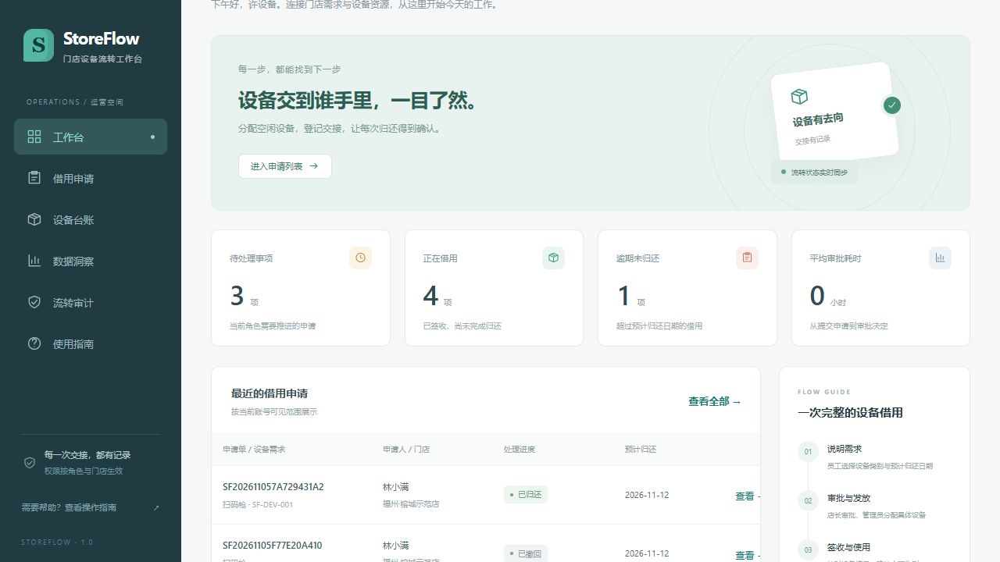
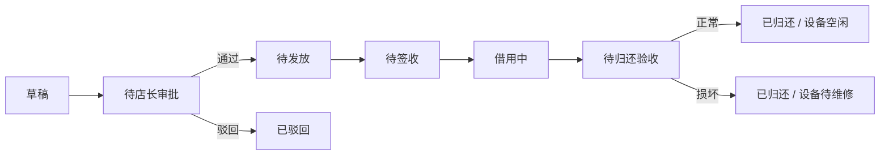

# StoreFlow · 门店设备借用与归还工作台

围绕连锁零售门店的扫码枪、标签打印机和平板，完成申请、店长审批、设备发放、员工签收、归还验收和异常设备处理。它是基于 Enterprise OA 的业务与工程改造项目，使用虚构门店及设备，适合本地学习和面试演示。

后端 Django / DRF，前端 Vue 3 / Element Plus。**在 PyCharm 安装 Python 依赖，运行根目录 `main.py` 即可演示。** 仓库包含已构建的前端，日常演示不需要 Node.js、API Key 或外部在线服务。第一次安装依赖需要网络。

## PyCharm 运行



1. 下载仓库 ZIP 并解压，或使用 Git 克隆；在 PyCharm 中打开 `main.py` 所在目录。
2. 创建 Python **3.12** 虚拟环境，选为项目解释器。
3. 在 PyCharm Terminal 执行：

   ```powershell
   python -m pip install -r requirements.txt
   ```

4. 右键根目录 `main.py` → **Run 'main'**。浏览器自动打开 **http://127.0.0.1:8765**。
5. 首次启动自动迁移数据库并创建演示数据；再次运行不会重置既有业务记录。停止时使用 PyCharm 停止按钮。

命令行同样支持：

```powershell
python main.py --check
python main.py
python main.py --no-browser --port 8766
```

`main.py` 按文件位置定位资源，不依赖 IDE 工作目录。端口占用时停止旧实例或换端口。数据保存在 `runtime/storeflow.sqlite3`，签名密钥保存在 `runtime/secret.key`，两者都不上传 GitHub。

## 演示账号

下列账号仅用于本机虚构业务演示，默认密码均为 **`Demo2026!`**。

| 账号 | 角色 | 用途 |
|---|---|---|
| `employee_a`、`employee_b` | 门店员工 | 第一家门店申请、签收、归还 |
| `employee_c`、`employee_d` | 门店员工 | 第二家门店的操作与隔离验证 |
| `manager_a`、`manager_b` | 店长 | 审批对应门店的申请 |
| `custodian` | 设备管理员 | 台账、发放、验收、维修后恢复 |
| `admin` | 系统管理员 | 基础配置、账号和审计 |

第一次初始化前设置 `STOREFLOW_DEMO_PASSWORD` 可替换演示密码。已有账号不会因为再次播种而重设密码。外部监听默认关闭演示初始化，需要显式设置 `STOREFLOW_DEMO=1` 才会创建演示数据。

## 核心业务



每张申请借用一台设备；申请时确定类别、用途和预计归还日期，发放时确定具体设备。审批通过不等于设备已经交付。未签收的发放可以撤销；归还未验收的设备不能重新分配；损坏设备必须确认修复后才能再发放。

门店员工处理本人申请，店长审批本门店，设备管理员负责实物交接，系统管理员维护基础资料。后端同样执行权限检查；不能通过普通表单修改关键状态绕过流程。

## 五分钟演示

1. `employee_a` 新建申请，选择类别、填写用途和未来归还日期，保存草稿后提交。
2. 换 `manager_a`，查看待办并通过。
3. 换 `custodian`，发放对应类别的一台空闲设备。
4. 换 `employee_a`，确认签收，再申请归还。
5. 换 `custodian`，正常验收，核对设备恢复空闲、详情时间线与统计。

另做一次损坏归还，验证设备进入待维修。完整步骤和本人验收清单见 [演示手册](docs/demo.md)。

## 测试与验证

```powershell
python backend/manage.py test
python scripts/test_database_tools.py -v
```

在演示服务已经启动时，可以另开终端执行 `python scripts/verify_http.py`，对实际 HTTP 服务验证登录、权限、流转、并发竞争与导出范围。该脚本会新增验收申请记录，仅用于虚构演示数据库。

前端修改后才需要 Node.js 并重新构建：

```powershell
cd frontend
npm ci
npm run build
```

实际环境、测试结果、浏览器操作和限制记录在 [验证记录](docs/verification.md)。自动化验证与本人操作验收分别记录，未执行项目不宣称通过。

## 备份与恢复

```powershell
python scripts/backup.py --output backups/interview.sqlite3
python scripts/restore.py --input backups/interview.sqlite3 --target runtime/restored.sqlite3
```

备份使用 SQLite 一致性备份 API。恢复只写入**新文件**，不会覆盖活动数据库；已有备份文件也不会覆盖。检查恢复结果后，在 PyCharm 环境变量设置 `STOREFLOW_DB_PATH` 指向恢复文件，再启动。容器、PostgreSQL 备份恢复见 [部署手册](docs/deployment.md)。

## 目录与来源

| 位置 | 内容 |
|---|---|
| `main.py` | PyCharm / 命令行启动入口 |
| `backend/` | 认证、权限、设备、借用流转、统计、接口测试 |
| `frontend/` | Vue 源码及随仓库提供的 `dist/` |
| `scripts/` | 数据库备份、恢复、验证工具 |
| `docs/` | 设计、部署、演示、验证、来源 |
| `runtime/` | 本地数据库、日志、签名密钥（Git 忽略） |

上游：[yanyihao-han/enterprise-oa](https://github.com/yanyihao-han/enterprise-oa)，参考提交 `c4a8df979a723ec9bf71e8cdd63dbbdcab14a678`。本仓库保留上游导入基线和后续改造。上游 README 声明 MIT，出处与复用范围见 [改造对照](docs/upstream.md)。本项目不代表任何企业内部系统或实际使用业绩。
